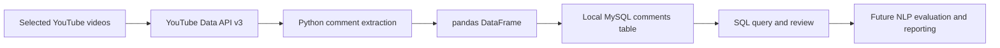

# UK Immigration Discussion Analysis Using YouTube Comments

> A data engineering and natural language processing project exploring how public YouTube audiences discuss UK immigration, beginning with API-based comment collection and structured MySQL storage.

**Status:** Data collection and database prototype implemented. Sentiment modelling, automated ETL and interactive deployment are planned rather than demonstrated.  
**Tools in current code:** Python, YouTube Data API v3, pandas, MySQL Connector, python-dotenv.  
**Planned tools:** Apache Airflow, NLP sentiment models and Streamlit.

## Executive Summary

Online discussions about UK immigration contain a variety of views, personal experiences, opinions and responses to news coverage. Analysing those discussions can illustrate how unstructured text is collected, stored and prepared for further natural language processing.

This repository implements an early-stage data pipeline that retrieves top-level comments from two selected YouTube videos and stores comment metadata and text in a local MySQL database. It includes a development notebook and Python script. The proposed later stages are text preparation, sentiment classification, model evaluation, workflow automation and visual reporting.

**Scope:** This is an analysis of selected online comments, not a representative survey of UK residents, a measure of immigration's economic effects or a reliable estimate of national public opinion.

## Research Question and Objectives

**Research question:** How can public comments on selected UK immigration-related YouTube videos be collected and prepared for an evidence-based analysis of expressed sentiment?

The project aims to:

1. Collect public comment data through the YouTube Data API.
2. Organise the data into a structured database with source and timestamp metadata.
3. Prepare text for future NLP classification and analysis.
4. Compare suitable sentiment approaches with manually reviewed examples.
5. Communicate findings with clear sampling limitations and responsible handling of user-generated content.

Only the first two objectives have corresponding extraction and database code in the current repository.

## Dataset and Collection Scope

The extraction script specifies two YouTube video IDs, `2F26DR3Be4g` and `vAVsczZ3Oqk`. The current API request uses `commentThreads().list` and `maxResults=100` for each video. It does **not** implement pagination, replies collection or repeated collection over time.

| Stored field | Description |
| --- | --- |
| `video_id` | Source video identifier |
| `author` | Public display name returned by the API |
| `published_at` | Comment publication timestamp |
| `updated_at` | Comment update timestamp |
| `like_count` | Engagement count supplied by the API |
| `text` | Comment body returned by the API |

The source video selection limits generalisability, and YouTube ranking or API ordering can influence which comments are retrieved. The repository does not commit a curated research dataset or verified sentiment label set.

## Architecture and Current Workflow



### Implemented

The script at `notebooks/Teslim-Sentiment-Analysis-using-Y2ouTube.py` reads configuration from environment variables, calls the YouTube Data API, extracts comment fields, prepares timestamps, creates a MySQL database and comments table, inserts records and queries the table.

The notebook `notebooks/Teslim-Sentiment-Analysis-using-YouTube.ipynb` documents these early stages and outlines the intended full project.

### Planned, not yet implemented

- A production-grade extraction process with pagination, retries and deduplication.
- Automated collection and transformation through an Airflow DAG.
- Text preprocessing, sentiment labelling and evaluation.
- Comparisons of TextBlob, VADER or transformer-based sentiment approaches.
- A Streamlit or Hugging Face Spaces application.

The committed Airflow DAG `airflow/dags/hello_world.py` runs a demonstration Bash command. It does **not** execute the YouTube ingestion or sentiment pipeline.

## Proposed Sentiment Analysis Methodology

Once the dataset is collected and cleaned, the next phase should define a clear annotation scheme for **positive**, **negative** and **neutral** expression, or a more topic-specific classification framework if the question concerns attitudes toward immigration.

Generic positive/negative sentiment is not the same as support for or opposition to immigration. Sarcasm, quoted statements, news reactions and multilingual comments may make automatic classification unreliable. Evaluate model performance on a manually reviewed sample, document agreement and error types, and report precision, recall and F1 where suitable.

Avoid presenting any sentiment percentages until the classification method, sample and validation results are available.

## Repository Structure

```text
README.md
notebooks/
    Teslim-Sentiment-Analysis-using-YouTube.ipynb
    Teslim-Sentiment-Analysis-using-Y2ouTube.py
airflow/
    dags/
        hello_world.py
    airflow.db
    airflow-webserver.pid
    logs/
requirements-TeSlimWindow.txt
-TeSlimWindow.gitignore
docs/
    legacy-readme.md
```

The repository currently tracks local Airflow runtime files and Python bytecode. These should normally be excluded from version control and removed from the tracked tree after checking for sensitive local data.

## Setup and Local Exploration

Install the currently declared Python dependencies:

```bash
git clone https://github.com/TeslimAdeyanju/UK-Immigration-YouTube-Sentiment.git
cd UK-Immigration-YouTube-Sentiment
python3 -m venv .venv
source .venv/bin/activate
python -m pip install -r requirements-TeSlimWindow.txt
```

The extraction script expects YouTube API and MySQL credentials in its environment. In its current form the script reads `API_KEY`, `MYSQL_USERNAME` and `MYSQL_PASSWORD`; an example local `.env` configuration is:

```dotenv
API_KEY=your-youtube-data-api-key
MYSQL_USERNAME=your-local-mysql-user
MYSQL_PASSWORD=your-local-mysql-password
```

**Not yet reproducible without changes:** The dependency list does not include all imports used by the extraction script, notably `python-dotenv` and `mysql-connector-python`. A running local MySQL server is required. The notebook and script also use inconsistent API key environment variable names, so configuration needs consolidation before execution. Do not commit your `.env` file.

The script currently inserts rows without a durable unique comment ID or upsert policy, so repeated executions can create duplicates. Review the code, credentials and database before running it.

## Validation and Research Limitations

1. **Selection bias:** Two selected videos cannot represent all YouTube discussions or UK public opinion.
2. **Collection completeness:** The current API calls collect a limited page of top-level comments without pagination.
3. **Model status:** No complete, evaluated sentiment classifier is demonstrated in this repository.
4. **Interpretation:** Emotional tone is distinct from political position or a claim about real-world immigration impacts.
5. **Reproducibility:** Dependencies, configuration and local MySQL provisioning need to be tested.
6. **Privacy:** Public handles and comment text are still user-generated personal information. Minimise unnecessary retention and avoid republishing identifiable comments.
7. **Workflow status:** The existing Airflow example does not schedule project data collection.

## Next Development Milestones

1. Standardise environment configuration and create a tested minimal requirements file.
2. Add pagination, API failure handling and stable comment identifiers for deduplication.
3. Separate extraction, transformation and storage into maintainable modules.
4. Remove generated Airflow artifacts from Git and establish a clean `.gitignore`.
5. Build a representative annotation and validation sample for NLP comparison.
6. Implement the project-specific Airflow DAG and verify end-to-end operation.
7. Produce transparent charts and an application only after the analysis is validated.

## Responsible Interpretation

This work investigates comments submitted by some viewers of particular videos. It should not be described as measuring the impact of immigration on the UK or the views of the UK population. Findings from future sentiment models must be qualified by sampling design, data quality and classification uncertainty.

## Author

**Teslim Adeyanju**  
[GitHub](https://github.com/TeslimAdeyanju) | [Portfolio](https://adeyanjuteslim.co.uk) | [LinkedIn](https://www.linkedin.com/in/adeyanjuteslimuthman)

[Original README archive](docs/legacy-readme.md)
